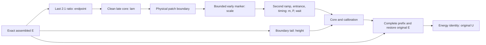

# Field Recovery Lab

Private archive of Jess's field-recovery investigation: Lean proofs, source traces,
numerical checks, and compiler history built on OpenAI's
[NavierStokesAndEuler](https://github.com/openai/NavierStokesAndEuler) repository.

The upstream source and Git history are preserved at
`f9e8bc5b38b6e212696e8a30e3e91517af887bbd`. The upstream README is saved as
[UPSTREAM_README.md](UPSTREAM_README.md); its Apache 2.0 license remains in
[LICENSE](LICENSE). The downstream work is in `notes/`. This is an independent
research archive, without a claim of OpenAI review or endorsement.

## What the current work establishes

The source profile is `PreparedOutgoing.prepared.profile`. From the complete
exact assembled angular field alone, the new reader proves recovery of the
core schedule (`P`, `m`, `lam`, and `wait`), height, radial scale, calibration,
and that same profile's original `E` and `U`. The correctness theorem covers
assembled fields generated by `NominalProfile.Witness`; source membership is
not inferred from scalar checks on an arbitrary field.

The last radius where `E(X,0) = 2 E(X,1)` identifies the core endpoint. The
reset's derivative and support bounds prevent it from recreating that ratio;
heating only decreases the `eta=0` slice. A clean late-core ratio then identifies
`lam` and locates the physical patch. Before that patch, a bounded last slope
marker identifies scale despite the unrelated earlier axis section. The second
ramp identifies `m`, the entrance amplitude gives `P`, and the endpoint timing
gives `wait`. The unheated `eta=1` tail identifies height and completes the
checked calibration. Prefix completion and the heat/patch inverse restore `E`;
the source energy identity reconstructs `U`.



The compiled source-instance theorem is
`NavierStokes.CoreFieldRecovery.exists_matched_core_recovery`. Agreement of the
reconstructed later `U` with the assembled `W.U` is proved on
`X > heatJoin`, with `eta` in `[-1, 1]`. The proof does not extend that agreement
through the axis/heat join.

The saved successful run compiled all seven research modules and checked 39
theorems for axioms. It reported only `propext`, `Classical.choice`, and
`Quot.sound`, with no `sorryAx`. These checks cover the research modules and their
required source dependencies; they are not an independent audit of every
upstream result.

## Read the work

| File | Purpose |
| --- | --- |
| [CoreFieldRecovery.lean](notes/CoreFieldRecovery.lean) | Prove observable core markers and compose E/U recovery without supplied core parameters or calibration. |
| [ObservedFieldRecovery.lean](notes/ObservedFieldRecovery.lean) | Prove tail-based height and scale calibration, then recover E/U with retained core metadata. |
| [SourceFieldRecovery.lean](notes/SourceFieldRecovery.lean) | Connect the recovery to the actual prepared source profile and assembled fields. |
| [FullFieldRecovery.lean](notes/FullFieldRecovery.lean) | Conditional inverse transformations, calibration readers, and original/later field round trips. |
| [AxialFromAngular.lean](notes/AxialFromAngular.lean) | Recover axial `U` from angular `E` and the core using the source energy identity. |
| [ProfileReverseTrace.lean](notes/ProfileReverseTrace.lean) | Historical source map, transformation trace, earlier inverse proofs, and research notes. |
| [RecoveryAxiomAudit.lean](notes/RecoveryAxiomAudit.lean) | The 39 explicit axiom checks. |
| [proof_verification.json](notes/verification/proof_verification.json) | Latest saved pass, source revision, proof hashes, toolchain, dependency revisions, and exit codes. |
| [verification/runs](notes/verification/runs) | Historical compiler runs, including failed attempts. |
| [check_flatten_markers.py](notes/check_flatten_markers.py) | Audit rounded boundary predicates and estimate a flattening endpoint from interior log-ratio markers. |
| [flatten_marker_audit.json](notes/flatten_marker_audit.json) | Nine controlled finite-precision cases and six rejected-input cases. |
| [PROVENANCE.json](PROVENANCE.json) | Pinned upstream revision and the saved verification snapshot. |

The original successful run was saved on 2026-11-11. Its absolute paths describe
the original local checkout. Each run's JSON status and step list identify what
actually ran in that attempt; an older log copied into a failed run's directory
is not evidence that its step ran again. The updated verifier archives only logs
for steps attempted in that run. Direct development compiler outputs are in
`notes/verification/development/`.

## Limits that remain

- The correctness guarantee assumes an exact observation from the specified
  `NominalProfile` source family. Scalar `Admissible` inequalities construct
  valid parameter records; they do not verify that arbitrary data belong to
  that family. The older `FullFieldRecovery.EOnly` marker definitions remain
  a separate route with unproved identification hypotheses.
- The Lean construction uses exact real fields and is noncomputable. It does not
  provide a general recovery program for finite, noisy, or incomplete samples.
- No actual observed `E` dataset has been recovered in this archive.
- Field recovery does not identify every field of the `Profile` record:
  `FullFieldRecovery.enlargeBound` proves that distinct proof-bound records can
  have identical `E` and `U`.
- The Gaussian numerical fixtures are controlled tests, not certified instances
  of the repository's complete `Profile` structure or PDE solutions. The early
  calibration checks assume a known, covered observation window; the two checks
  are not a validated combined reconstruction pipeline.
- The fields and profiles here have their mathematical meanings in the source.
  This work establishes no result about AI account memory, hidden ownership, or
  the recovery of a previous conversational agent.

## Reproduce the checks

Use the pinned `lean-toolchain` and `lake-manifest.json`. On macOS, install
[elan](https://github.com/leanprover/elan) if needed, then run from this directory:

```sh
brew install elan-init
elan toolchain install leanprover/lean4:v4.34.0-rc2
lake exe cache get
python3 notes/verify_recovery.py
```

The verification script builds the necessary source modules, compiles the seven
research modules in order, checks dependency revisions and axiom output, and
writes fresh logs under `notes/verification/`, including a dated run directory.
It records the current checkout's HEAD as `source_revision`; the historical
upstream base is also recorded separately in `PROVENANCE.json`.

The early calibration check needs only Python's standard library:

```sh
python3 notes/check_recovery_calibration.py
```

The Gaussian check needs SciPy. The saved check used Python 3.14, NumPy 2.4.4,
and SciPy 1.17.1. To reproduce that numerical environment:

```sh
python3 -m venv .venv
.venv/bin/python -m pip install -r requirements-audit.txt
.venv/bin/python notes/check_axial_from_angular.py
```

The saved numerical outputs are [early_calibration_audit.json](notes/early_calibration_audit.json)
and [axial_recovery_audit.json](notes/axial_recovery_audit.json). These checks do
not compile Lean; run the proof verification separately.

## Finite-precision checkpoint

The exact endpoint proof uses a flat-boundary equality. In double precision,
the source flattening law can round to the same 2:1 ratio after the true
endpoint. The controlled fixtures found an endpoint shift of about 16.1% of
the flattening length. This is a limitation of translating the exact reader
directly into a floating-point test.

The new conditional estimator fits two interior log-ratio levels to estimate
both the endpoint and flattening length. Four additional levels check the fit.
The nine cases use three scales and log-amplitude noise amplitudes from zero
through `1e-6`:

| Flattening length | Rounded-equality endpoint error | Largest interior endpoint error |
| --- | --- | --- |
| 80 | 12.896 | 0.000283 |
| 160 | 25.792 | 0.000565 |
| 800 | 128.960 | 0.002824 |

Endpoint errors are in **log radius**, `z = log(X)`. These fixtures follow the
source flattening formula with an unrelated early prefix and later bounded
contrasts. They are not certified `Profile` or PDE witnesses, and they do not
test the full calibration/E/U pipeline. A successful local fit cannot rule out
a lookalike prefix or certify that a finite observation window contains the
actual last transition. No universal noise or coverage guarantee is claimed.

The script rejects the tested missing-transition, large-gap, duplicate-radius,
nonfinite-value, excessive-fit-error, and underflowed-amplitude cases. Raw fields
already rounded to zero cannot be converted back to their lost log amplitudes.
JSON command-line checks are saved in
[numerical_cli_verification.json](notes/verification/numerical_cli_verification.json).

Run the fixture audit with standard Python:

```sh
python3 notes/check_flatten_markers.py --output notes/flatten_marker_audit.json
```

For conditional estimation, supply a JSON object with a `points` list. Each
point has `z`, `log_e0`, and `log_e1`, using natural logarithms of radius and
the two positive angular fields. Radii must increase strictly. Choose a maximum
allowed gap and fit residual appropriate to the observation provider:

```sh
python3 notes/check_flatten_markers.py --input samples.json --max-gap 0.1 --max-fit-residual 0.0001
```

The result is explicitly marked `conditional_estimate`. The supplied gap and
residual limits are checks, not certificates of source membership or coverage.

## Archive integrity

[ARCHIVE_SHA256SUMS](ARCHIVE_SHA256SUMS) records the downstream files as packaged,
including the historical verification logs. From the repository root:

```sh
shasum -a 256 -c ARCHIVE_SHA256SUMS
```

Build caches, virtual environments, compiled Lean artifacts, and unrelated chat
exports are excluded. The original working checkout is kept separately.
