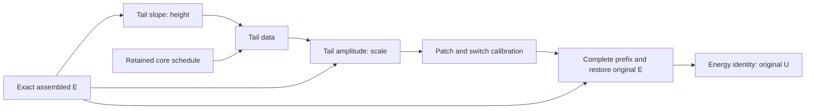

# Field Recovery Lab

Private archive of Jess's field-recovery investigation: Lean proofs, source traces,
numerical checks, and compiler history built on OpenAI's
[NavierStokesAndEuler](https://github.com/openai/NavierStokesAndEuler) repository.

The upstream source and Git history are preserved at
`f9e8bc5b38b6e212696e8a30e3e91517af887bbd`. The upstream README is saved as
[UPSTREAM_README.md](UPSTREAM_README.md); its Apache 2.0 license remains in
[LICENSE](LICENSE). The downstream work is in `notes/`. This is an independent
research archive, without a claim of OpenAI review or endorsement.

## What the current work establishes

The source profile is `PreparedOutgoing.prepared.profile`. Given its retained
core schedule (`P`, `m`, `lam`, and `wait`) and the complete exact assembled
angular field, the new reader proves recovery of that same profile's original
`E` and `U`. A matching calibration is no longer a supplied input to this route.

The reader uses the unheated boundary slice `eta = 1`. Its eventual logarithmic
slope determines height `h`; with the retained core, the tail's amplitude
determines a unique radial scale. The reader derives the patch and switch
radii, completes the known outgoing prefix below the heat join, and applies
the heat/patch inverse followed by the source energy identity for `U`.



The compiled source-instance theorem is
`NavierStokes.ObservedFieldRecovery.exists_matched_observed_recovery`. Agreement of the
reconstructed later `U` with the assembled `W.U` is proved on
`X > heatJoin`, with `eta` in `[-1, 1]`. The proof does not extend that agreement
through the axis/heat join.

The saved successful run compiled all six research modules and checked 23
theorems for axioms. It reported only `propext`, `Classical.choice`, and
`Quot.sound`, with no `sorryAx`. These checks cover the research modules and their
required source dependencies; they are not an independent audit of every
upstream result.

## Read the work

| File | Purpose |
| --- | --- |
| [ObservedFieldRecovery.lean](notes/ObservedFieldRecovery.lean) | Prove tail-based height and scale calibration, then recover E/U with retained core metadata. |
| [SourceFieldRecovery.lean](notes/SourceFieldRecovery.lean) | Connect the recovery to the actual prepared source profile and assembled fields. |
| [FullFieldRecovery.lean](notes/FullFieldRecovery.lean) | Conditional inverse transformations, calibration readers, and original/later field round trips. |
| [AxialFromAngular.lean](notes/AxialFromAngular.lean) | Recover axial `U` from angular `E` and the core using the source energy identity. |
| [ProfileReverseTrace.lean](notes/ProfileReverseTrace.lean) | Historical source map, transformation trace, earlier inverse proofs, and research notes. |
| [RecoveryAxiomAudit.lean](notes/RecoveryAxiomAudit.lean) | The 23 explicit axiom checks. |
| [proof_verification.json](notes/verification/proof_verification.json) | Latest saved pass, source revision, proof hashes, toolchain, dependency revisions, and exit codes. |
| [verification/runs](notes/verification/runs) | Historical compiler runs, including failed attempts. |
| [PROVENANCE.json](PROVENANCE.json) | Pinned upstream revision and the saved verification snapshot. |

The original successful run was saved on 2026-11-11. Its absolute paths describe
the original local checkout. Each run's JSON status and step list identify what
actually ran in that attempt; an older log copied into a failed run's directory
is not evidence that its step ran again. The updated verifier archives only logs
for steps attempted in that run. Direct development compiler outputs are in
`notes/verification/development/`.

## Limits that remain

- The new route requires the original core schedule as retained metadata. Its
  height, radial scale, patch radius, and switch radius are proved to match the
  source from the exact assembled field. Automatic recovery of an unknown core
  by the older `FullFieldRecovery.EOnly` reader remains unproved.
- The Lean construction uses exact real fields and is noncomputable. It does not
  provide a general recovery program for finite, noisy, or incomplete samples.
- No actual observed `E` dataset has been recovered in this archive.
- The Gaussian numerical fixtures are controlled tests, not certified instances
  of the repository's complete `Profile` structure or PDE solutions. The early
  calibration checks assume a known, covered observation window; the two checks
  are not a validated combined reconstruction pipeline.
- The fields and profiles here have their mathematical meanings in the source.
  This work establishes no result about AI account memory, hidden ownership, or
  the recovery of a previous conversational agent.

## Reproduce the checks

Use the pinned `lean-toolchain` and `lake-manifest.json`. On macOS, install
[elan](https://github.com/leanprover/elan) if needed, then run from this directory:

```sh
brew install elan-init
elan toolchain install leanprover/lean4:v4.34.0-rc2
lake exe cache get
python3 notes/verify_recovery.py
```

The verification script builds the necessary source modules, compiles the six
research modules in order, checks dependency revisions and axiom output, and
writes fresh logs under `notes/verification/`, including a dated run directory.
It records the current checkout's HEAD as `source_revision`; the historical
upstream base is also recorded separately in `PROVENANCE.json`.

The early calibration check needs only Python's standard library:

```sh
python3 notes/check_recovery_calibration.py
```

The Gaussian check needs SciPy. The saved check used Python 3.14, NumPy 2.4.4,
and SciPy 1.17.1. To reproduce that numerical environment:

```sh
python3 -m venv .venv
.venv/bin/python -m pip install -r requirements-audit.txt
.venv/bin/python notes/check_axial_from_angular.py
```

The saved numerical outputs are [early_calibration_audit.json](notes/early_calibration_audit.json)
and [axial_recovery_audit.json](notes/axial_recovery_audit.json). These checks do
not compile Lean; run the proof verification separately.

## Archive integrity

[ARCHIVE_SHA256SUMS](ARCHIVE_SHA256SUMS) records the downstream files as packaged,
including the historical verification logs. From the repository root:

```sh
shasum -a 256 -c ARCHIVE_SHA256SUMS
```

Build caches, virtual environments, compiled Lean artifacts, and unrelated chat
exports are excluded. The original working checkout is kept separately.
